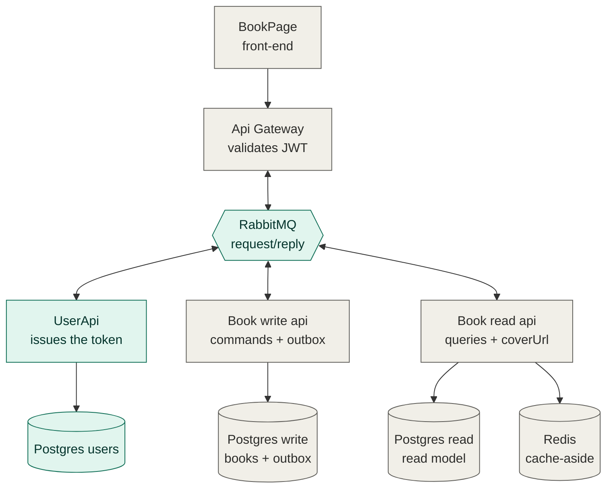
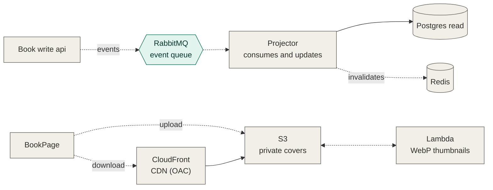

# UserBookShareApi

User service (UserApi) of the book platform. It handles registration and authentication: it registers users, validates credentials and issues the JWT. It receives requests through RabbitMQ (request/reply) and, optionally, through HTTP for local testing.

## System overview

The UserApi is the first piece of a larger book platform built with CQRS. Green boxes are implemented, gray boxes are planned.

### Request path



### Event path and covers

Dashed arrows are asynchronous.



Write operations store the book and an outbox record in the same transaction. The Projector consumes the resulting events and keeps the read model (and the cache) up to date, so reads never touch the write database.

## Architecture

The project follows Clean Architecture. Dependencies always point inward:

```
interfaces -> application -> domain
infrastructure -> application (implements the ports)
```

| Layer | Responsibility |
|---|---|
| `domain` | `User` entity and business rules. It does not import any external library. |
| `application` | Use cases (`RegisterUser`, `Login`) and ports (`UserRepository`, `PasswordHasher`, `TokenIssuer`). |
| `infrastructure` | Port implementations: Postgres (pgx), bcrypt and JWT RS256. |
| `interfaces` | Input adapters: RabbitMQ consumer and HTTP handlers. |
| `cmd/api` | Composition root: reads the configuration, wires the dependencies and starts the adapters. |

Swapping the database, the hash algorithm or the input protocol means writing a new implementation of a port, without touching `domain` or `application`.

## Structure

```
cmd/api/main.go
db/init.sql
internal/
  domain/
  application/
  exception/
  infrastructure/
    postgres/
    security/
  interfaces/
    httpapi/
    messaging/
Dockerfile
docker-compose.yml
```

## Tech stack

- Go
- PostgreSQL (pgx)
- RabbitMQ (amqp091-go)
- bcrypt for passwords
- JWT with RS256 (golang-jwt)
- chi (optional HTTP router)
- Docker and Docker Compose

## Running

Prerequisites: Docker and Docker Compose.

1. Generate the RSA key pair in the project root:

```bash
openssl genrsa -out private.pem 2048
openssl rsa -in private.pem -pubout -out public.pem
```

2. Start the services:

```bash
docker compose up --build
```

Compose starts PostgreSQL (port 5433 on the host), RabbitMQ (port 5672, management UI at http://localhost:15672, user and password `guest`) and the API. The `users` table is created automatically by `db/init.sql`.

`*.pem` files are not versioned.

## Configuration

| Variable | Description | Required |
|---|---|---|
| `DATABASE_URL` | PostgreSQL connection string | Yes |
| `RABBITMQ_URL` | RabbitMQ connection URL | Yes |
| `JWT_PRIVATE_KEY_PATH` | Path to the RSA private key | Yes |
| `HTTP_ADDR` | HTTP server address (for example `:8080`). If empty, HTTP does not start | No |

## Message contract

The API consumes the `user.register` and `user.login` queues. Each message must carry the `reply_to` and `correlation_id` properties; the response is published to the queue given in `reply_to`, with the same `correlation_id`.

### user.register

Request:

```json
{"name": "Joao", "email": "j@x.com", "password": "123456"}
```

Success response:

```json
{"ok": true, "data": {"id": "2911b634-82c5-42cd-b29e-fa88f62a6a48"}}
```

### user.login

Request:

```json
{"email": "j@x.com", "password": "123456"}
```

Success response:

```json
{"ok": true, "data": {"token": "<jwt>"}}
```

### Errors

```json
{"ok": false, "error": {"code": "EMAIL_ALREADY_EXISTS", "message": "email already exist"}}
```

| Code | Meaning | HTTP equivalent |
|---|---|---|
| `INVALID_INPUT` | Invalid body or a field failed validation | 400 |
| `INVALID_CREDENTIALS` | Unknown email or wrong password | 401 |
| `EMAIL_ALREADY_EXISTS` | Email already registered | 409 |
| `INTERNAL` | Internal error | 500 |

An unknown email and a wrong password return the same error, so the API does not reveal which emails are registered.

## Optional HTTP

When `HTTP_ADDR` is set, the API exposes:

| Method | Route | Description |
|---|---|---|
| POST | `/users` | Registers a user |
| POST | `/login` | Authenticates and returns the token |

In production, HTTP lives in the API Gateway and the UserApi runs with the consumer only.

## Security

- Passwords are stored with bcrypt. bcrypt's 72-byte limit is validated.
- The JWT is signed with RS256. Only the UserApi holds the private key; the gateway validates with the public key.
- Emails are normalized (lowercase, trimmed) on registration and login.
- Email uniqueness is enforced by the database `UNIQUE` index, which covers the race condition between the existence check and the insert.

## Tests

```bash
go test ./... -cover
```

The use cases are tested with in-memory fakes (repository, hasher and token issuer), with no dependency on a database, a queue or bcrypt.

## Next steps

- Unit tests for the `domain` package
- API Gateway: HTTP, JWT validation and publishing to RabbitMQ
- Book services (write, read and projector)
